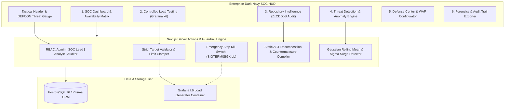

# BLACKSHIELD — Critical Infrastructure Cyber Defense Platform
### National Emergency Response Security Operations Center (SOC) & Resilience Platform

[](https://nextjs.org/)
[](https://www.typescriptlang.org/)
[](https://tailwindcss.com/)
[](https://www.prisma.io/)
[](https://www.postgresql.org/)
[](https://k6.io/)
[](https://www.docker.com/)

---

## 1. Mission & Operational Context

**BLACKSHIELD** is an enterprise-grade, defensive Security Operations Center (SOC) platform engineered for national emergency management and critical infrastructure protection agencies (e.g. 911 emergency call intake, FEMA strategic coordination gateways, municipal power grid SCADA monitors, and emergency medical resource locators) facing sophisticated Distributed Denial of Service (DDoS) threats.

The platform provides end-to-end operational defense:
1. **Real-Time SOC Observability**: Continuous telemetry tracking availability, compute load, network ingress/egress, and request-rate velocities.
2. **Controlled Load Testing (k6)**: Safe, synthetic resilience benchmarks with hard guardrails and instant emergency kill switches.
3. **Repository Intelligence**: Defensive static code analysis of weaponized stresser toolkits (such as `naimxbzbd/ZxCDDoS`) without ever executing attack functionality.
4. **Threat Detection & Anomaly Engine**: Gaussian rolling baseline statistics and Z-score deviation detectors with MITRE ATT&CK mapping.
5. **Perimeter Defense Center**: Dynamic Token Bucket rate limiters, Cloudflare/ModSecurity WAF rule generators, IP reputation feeds, and kernel-level SYN cookie hardening.
6. **Forensics & Incident Post-Mortems**: Cryptographic operator audit trails, printable executive incident reports, and SIEM JSON export streams.

---

## 2. Core Modules



### Module 1: SOC Dashboard
- **National Emergency Target Availability**: Real-time heartbeat checks on 5 national emergency infrastructure targets (911 Dispatch, FEMA Hub, Power Grid Telemetry, Emergency SMS Relay, Hospital Bed Status).
- **Resource HUD**: CPU, RAM, Network Ingress/Egress (Gbps/Mbps), Active Socket Descriptors, and Worker Threads.
- **Traffic Telemetry**: Ingress vs Processed RPS, Malicious Drop Rate, Protocol Breakdown (HTTP/2, HTTPS, TCP, UDP).
- **Threat Level HUD**: DEFCON / Threat Level gauge (DEFCON 1 to 5), active attack alerts, blocked malicious requests counter, and mitigation status badge.

### Module 2: Controlled Load Testing
- **Target Verification Policy**: Validates URL against strict regex (`^(https?:\/\/)?(localhost|127\.0\.0\.1|::1|.*\.internal\.local|.*\.defense\.test)(:\d+)?(\/.*)?$`). Disallows public/external domains with explicit safety rejection.
- **Hard Limits**: Concurrency capped at 200 VUs, maximum duration 300s, request rate ceiling 5,000 RPS.
- **Execution Controller**: Executes `k6 run` with dynamic script generation or node-based high-concurrency synthetic engine. Captures stdout/stderr, aggregates latency percentiles (p50, p90, p95, p99), throughput, and error rates.
- **Emergency Stop**: Instant kill switch with process group termination and safety status broadcast.

### Module 3: Repository Intelligence (Defensive Analysis of ZxCDDoS)
- **Target Repository**: `https://github.com/naimxbzbd/ZxCDDoS/tree/main`.
- **Zero-Execution Rule**: Never executes malicious routines. Analyzes source files statically via lexical pattern matching and AST scanning.
- **Deconstructed Vectors**:
  - `c2.py`: Telnet listener, plaintext authentication, thread dispatching, command protocol parsing (`!* <method> <ip> <port> <time>`).
  - Layer 7: HTTP GET/POST flood, HTTP/2 multiplexing saturation, Cloudflare UAM bypass emulation via User-Agent and proxy pool rotation.
  - Layer 4: Raw socket TCP SYN flood (`SOCK_RAW`, TCP backlog exhaustion), UDP flood, ACK floods.
  - Amplification / Reflection: Exploits of NTP monlist, DNS ANY queries, SSDP reflection vectors.
- **Automated Countermeasure Generation**:
  - Suricata & Snort IDS rules.
  - Cloudflare WAF expression rules (`http.request.uri.path contains ...`).
  - Nginx rate-limiting & connection-limiting snippets (`limit_req_zone`, `limit_conn_zone`).
  - Linux kernel sysctl hardening parameters (`net.ipv4.tcp_syncookies = 1`, `net.ipv4.tcp_max_syn_backlog = 65536`).

### Module 4: Threat Detection & Anomaly Engine
- **Telemetry Analysis**: Computes rolling Z-scores and Exponential Moving Averages (EMA) on request rates.
- **Alert Generation**: Automatic classification into CRITICAL, HIGH, MEDIUM, and LOW severity.
- **MITRE ATT&CK Mapping**: Links detected events to T1498 (Network Denial of Service) and T1499 (Endpoint DoS).
- **Incident Timeline**: Interactive chronological visualization of an ongoing or past attack sequence.

### Module 5: Defense Center
- **Dynamic Mitigation Switch**: Global "Under Attack" emergency mitigation mode toggle.
- **Rate Limiting Policies**: Token bucket configuration per endpoint (e.g. `/api/auth/login`, `/api/dispatch`).
- **WAF Rule Engine**: Live rule enable/disable with rule syntax preview for Cloudflare, AWS WAF, and ModSecurity.
- **IP Reputation & Geo-Filtering**: Malicious ASN blocking, known Tor exit nodes, and automated botnet quarantine.

### Module 6: Forensics & Exportable Reports
- **Incident Audit Trail**: Immutable cryptographic log records tracking operator actions and system mitigations.
- **Executive PDF Report Generator**: Generates formatted, publication-ready Incident Response Post-Mortem reports.
- **SIEM Export**: JSON and CSV export formats formatted for Splunk, Elastic SIEM, and Azure Sentinel.

---

## 3. Technology Stack

- **Framework**: Next.js 15 (App Router, Server Actions, React 19)
- **Language**: TypeScript 5.7 (Strict Mode)
- **Styling**: Tailwind CSS 3.4 (Custom Dark Navy SOC Cyber Theme)
- **Data Visualization**: Recharts (Responsive Area, Line, Bar, and Gauge Telemetry)
- **Database & ORM**: PostgreSQL 16 & Prisma ORM 6.4 (with instant local SQLite dev mode)
- **Load Testing**: Grafana k6 & Synthetic High-Concurrency Harness
- **Containerization**: Multi-stage production `Dockerfile` and `docker-compose.yml`

---

## 4. Quickstart Guide

### Option A: Local Development (Instant Zero-Dependency Setup)

```bash
# 1. Clone & Enter Project Directory
cd "c:\Users\ASUS\OneDrive\Desktop\server Test"

# 2. Install Dependencies
npm install

# 3. Initialize & Seed Database (Runs SQLite locally without needing external Postgres)
npx prisma db push
node prisma/seed.js

# 4. Start Next.js Development Server
npm run dev
```

Visit **`http://localhost:3000`** in your browser to access the live BLACKSHIELD platform.

### Option B: Docker Production Deployment

```bash
# Spin up Next.js Web App, PostgreSQL 16, and Grafana k6 runner
docker compose up --build -d
```

Check health and logs:
```bash
docker compose logs -f blackshield-web
```

---

## 5. Automated Verification Test Suite

BLACKSHIELD includes a standalone autonomous verification test suite that verifies database persistence, all 9 API endpoints, the controlled testing guardrail enforcer, the ZxCDDoS static AST analyzer, and the anomaly detector:

```bash
npm run test:system
# or
node scripts/verify-blackshield.js
```

---

## 6. Security & Ethical Policy

1. **Defensive Posture Only**: BLACKSHIELD is strictly built for cyber defense, resilience testing, and availability monitoring.
2. **Zero Attack Execution**: The repository intelligence module analyzes code statically. Under no circumstances does it compile or invoke attack scripts from analyzed repositories.
3. **Hard Guardrails on Load Testing**:
   - Any external target not in the loopback or internal authorized sandbox is rejected with a 403 Forbidden security error.
   - Resource ceilings are enforced in code: Max 200 VUs, max 300 seconds, max 5,000 RPS.
   - An immediate Emergency Stop kill switch terminates all synthetic load generators in milliseconds.
